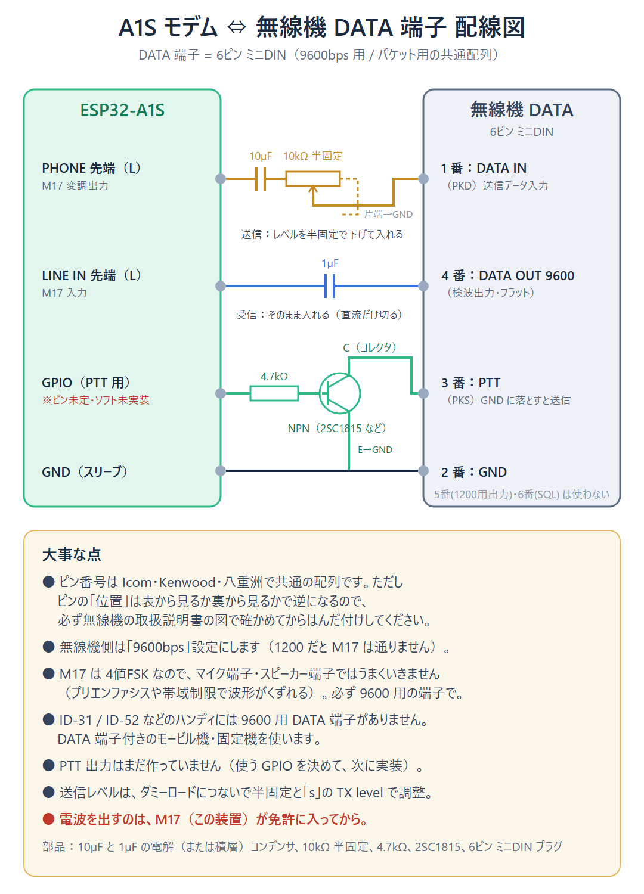

# M17 の作業のまとめ

ここは **M17**（オープンな規格のデジタル音声、声の圧縮は **Codec 2**）の作業を、まとめて管理する場所です。
特許のある AMBE を使わない、正攻法の系統として 2026-11-14 に始めました。

* **フォルダ**：`Desktop\ambe_m17`（git worktree）
* **ブランチ**：`m17`。GitHub への push は持ち主が手で行う。
* **2026-11-16 から、`v2` とは切り離しました。**
  * M17 の変更は、このフォルダの `m17` ブランチにだけ入れます。
  * `v2`（AMBE の VERSION 2、`Desktop\ambe_wifi`）には、M17 の初期の版（9433c0b まで）が残っていますが、これ以上は更新しません。
* AMBE 関係のコード（mbelib-neo・dstar_pc・ysf_pc）は、M17 の部品からは一切使っていません。

## 部品

| フォルダ | 中身 | 説明書 |
|---|---|---|
| `m17_pc\` | Windows の M17 局。3 つのモードがある。**リフレクター**（インターネット、UDP 17000）、**無線機**（PC のサウンドカードで 4値FSK を作る）、**中継**（無線機 ⇔ リフレクター、無線機からの操作つき） | [m17_pc/README.md](m17_pc/README.md) |
| `m17_modem\core\` | M17 の電波側（フレーム・誤り訂正）と 4値FSK の変復調。m17_pc と A1S の両方が使う | [m17_modem/README.md](m17_modem/README.md) |
| `m17_modem\esp32\` | ESP32-A1S（ES8388）のモデム。Codec 2 ＋ 4値FSK を送受同時に動かす | 同上 |
| `m17_modem\pc\` | 電波側の検査と往復試験（`m17_rf_test`） | 同上 |
| `taikou-test1-1\` | IC-705 2 台の対向試験（ダミーロード）：送信の音声処理の実測と、M17 の試験送信（補正なし・推定・実測値）。m17_pc とは別のプログラム | [taikou-test1-1/README.md](taikou-test1-1/README.md) |
| `docs\m17\` | 配線図など | — |

## ビルド

```
m17_pc\build.bat               → build_m17_pc\m17_pc.exe（画面）, m17_cli.exe（コマンド）, m17_test.exe
m17_modem\pc\build.bat         → build_m17_modem_pc\m17_rf_test.exe
m17_modem\esp32                → ESP-IDF 5.1.6（PowerShell から idf_env.bat、idf.py build）
```

* Codec 2 は `%USERPROFILE%\tools\codec2`（v1.2.0、LGPL-2.1、静的リンク）を使う。
* w64devkit は `%USERPROFILE%\tools\w64devkit` にある。

## m17_pc のモード（画面の「接続先」）

| モード | 動き |
|---|---|
| リフレクター | M17 リフレクター（mrefd）に接続して交信する。内蔵のパロットで試験できる。接続時に、総務省の無線局等情報検索をブラウザで開く（照合しても機能は止めない） |
| 無線機 | 無線機の 9600bps 用 DATA 端子と、PC の音声入出力をつなぐ。PTT は RTS、DTR、CI-V（IC-705 はアドレス A4）から選ぶ |
| 中継 | 無線機で受けた通話をリフレクターへ送る。設定で許可したときだけ、リフレクターの通話を無線機から送信する。無線機の宛先欄で操作できる：`M17-XXX A`（接続）、`UNLINK`、`ECHO`、`INFO` |

## 無線機とのつなぎ方



* **6 ピン ミニDIN（DATA 端子）**のピン：1 DATA IN、2 GND、3 PTT、4 DATA OUT 9600、5 DATA OUT 1200、6 SQL。番号は Icom・Kenwood・八重洲で共通。ピンの位置は、必ずその無線機の取扱説明書の図で確かめる。
* PTT は **GND に落とすと送信**（NPN トランジスタのオープンコレクタで落とす）。ハンディ機のマイク端子は、マイク線を抵抗を通して GND 側へ引き込む方式。
* **マイク端子・スピーカー端子では M17 は通らない。** 300 Hz〜3 kHz の帯域を通すと、雑音がなくても 1 フレームも復調できないことを、PC の試験で確かめた。
  * ID-31・ID-52 には 9600 用の端子がない。
  * IC-705 の USB オーディオは声の帯域の処理を通る。そこで 2026-11-17 から、受信は 12 kHz の IF 出力を PC で検波し、送信は無線機の音声処理を先に打ち消す方法を m17_pc に入れた（[m17_pc/README.md](m17_pc/README.md) の「IC-705 を USB で」）。2026-11-18〜19、2 台の対向試験で、taikou-test1-1 で作る送信イコライザーを使って実機で通った。
* **A1S の端子**
  * PHONE の先端（左）：M17 の変調出力
  * PHONE のリング（右）とスピーカーの ROUT：受信した声
  * LINE IN の先端：M17 の入力
  * スピーカーの LOUT：使わない
  * KEY1（GPIO36）：PTT
  * シリアル：115200
* **2 台の A1S**
  * 1 台目：フラッシュ 8 MB
  * 2 台目：フラッシュ 4 MB。書き込みは `--flash_size detect` を付ける。
  * USB 変換（CP2102）のシリアル番号がどちらも同じなので、Windows は同時に 1 台しか認識しない。
* **ESP32-S3 版にするとき**の AD/DA は、ES8388 モジュール（今のドライバがそのまま使える）か、PCM5102A ＋ PCM1808 の組み合わせ。

## 確かめたこと、まだのこと（2026-11-16）

| 項目 | 確かめた | まだ |
|---|---|---|
| リフレクター接続 | 内蔵パロットで往復。音は c2enc/c2dec と全サンプル一致。2026-11-17 本物の M17-M17（m17.openquad.net）の A に接続 → ACKN、PING に PONG で 45 秒保持 → DISC で切断。同日、宛先 `#PARROT` に 3.6 秒（91 パケット）送信 → 91 パケット欠けなしで返ってきて、音は c2enc/c2dec と 28,800 サンプルすべて一致 | ほかの局との交信、ほかのリフレクター |
| 電波側（core） | M17 の規格書の検査値と一致。PC で SNR 8 dB、極性反転、直流が乗っても復号できる | — |
| A1S モデム | ケーブルで折り返し 750 フレームがビット一致。2 台の向かい合わせで受信と試験音を確認 | 実際の無線機 |
| 無線機モード | PC の中の折り返しで、SNR 8 dB まで欠落 0。極性反転を検出 | 実際のサウンドカード、無線機、PTT |
| IC-705 を USB で（2026-11-17〜19） | 2 台の対向試験（ダミーロード、FM-D）。FM-D でもプリエンファシスあり（実測）。大きさの補正だけでは通らず、送ったバーストから作るイコライザー（`fm_eq.c`）で通る。taikou-test1-1 の B4 は、イコライザーなしの受信機で 100 フレーム誤り 0（2 回）。m17_pc どうしで 10 秒の声：251 フレーム受信、欠落 9・CRC 誤り 4 | ほかの M17 機（MMDVM など）との交信、イコライザーをいつ作り直すか |
| 中継 | 両方向とも 75 フレーム欠けなし。中継の電波を再び中継しない。宛先コマンドを一通り試験 | 本物のリフレクター、無線機の表示、途中から受けたコマンド |
| A1S 操作パネル | 階層メニューをシリアルで操作。リフレクターのモジュールを選んで `Link` すると、0.5 秒のコマンド送信。設定の保存 | 中継局の返事の表示（PC の中継モードとケーブルでつなげば試せる）、本物のつまみと画面、画面の雑音 |

## 守ること

* **電波を出すのは、M17（4値FSK）での送信が自局の免許の範囲に入ってから。** 調整はダミーロードで行う。
* 中継で、リフレクターの通話を自局の電波で送る機能は、免許や運用の条件で認められるか確かめてから使う。無人で動かさない。
* Codec 2 は LGPL-2.1。配布するときは、ソースの入手先（https://github.com/drowe67/codec2 、v1.2.0）を添える。
* 配布は、信頼できる人に手で渡す ZIP だけ。公開はしない。
* 照合や一覧の取得で、ボット確認や 403 を回避しない。

## note の記事（下書きは claude.ai の Docs、画像は `Desktop\m17_note画像`）

1. Codec 2 と AMBE の聞き比べ（音源は `Desktop\codec2_聞き比べ`）
2. M17 リフレクターにつながるアプリ（m17_pc）
3. FM無線機をM17に！ESP32-A1Sで「モデム」を作ってみた

## これからの候補

* 実際の無線機で、無線機モードと中継を試す（免許の範囲に入ってから）。
* A1S の操作パネルの部品を付ける。
  * 画面は、反射型の 128×64 液晶（ST7567 など）がおすすめ。OLED は「ジー」という雑音と、日なたでの見づらさが心配。
  * つまみは EC11（押しボタン付き）を、KEY のピンにつなぐ。
  * 画面は、ES8388 と同じ I2C を共用する。
  * 画面の電源には、フェライトビーズとコンデンサを入れる。
* A1S を USB モデムにして、PC とつなぐ方式。
* ESP32-S3 版のモデム。
* 中継の `INFO` や接続結果を、音声の案内で知らせる。
* **IC-705 の FM-D で M17 の交信が確立できたら、その次**：FreeDV 2400B（Codec 2 の 1300 bps。普通の FM 無線機のマイク・スピーカー経路を通すための方式）を電波側に使い、m17_pc で M17 リフレクターと相互に変換する。ID-31・ID-52 など DATA 端子のない無線機でも使える。電波は M17 ではない、変換で音が落ちる、免許の確認が要る。
